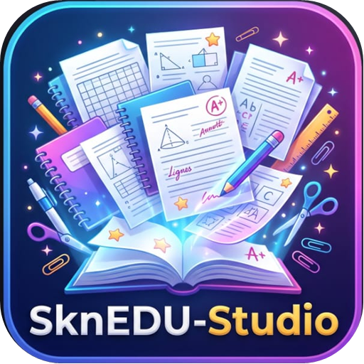

<p align="center"></p>

# SknEDU-studio

Éditeur PDF **hors-ligne** pour enseignants (Windows) : créer, modifier, organiser, scanner, rendre le texte des scans
modifiable (OCR), protéger, signer, comparer, convertir et préparer ses cours avec l'IA.

Liens : [Historique des versions](CHANGELOG.md) · [Politique de signature de code](CODE_SIGNING.md) · [Confidentialité](PRIVACY.md) · [Sécurité](SECURITY.md) · [Téléchargements](https://github.com/ZintaSkn/edupdf-studio/releases/latest)

**Modèle** : code source libre (AGPL-3.0) ; la version officielle demande un compte, offre 30 jours d'essai de toutes les
fonctions puis une version gratuite, et des licences Enseignant / Établissement pour les fonctions Premium (voir « Éditions et offres »).

Couleurs : bleu marine **#001871** et or **#F1B434**, deux couleurs complémentaires ; leur dégradé (bleu → turquoise → vert → or) forme les vagues signature et toutes les nuances de l'interface.

## Éditions et offres

Au premier démarrage, l'utilisateur crée son **compte** (adresse e-mail, obligatoire) et bénéficie de **30 jours d'essai
de toutes les fonctions**, une seule fois par ordinateur. Ensuite : **version gratuite** (lire, annoter, organiser,
remplir, signer, imprimer) ou **licence Enseignant / Établissement** pour les fonctions Premium (modification du texte,
OCR, conversions Office, assistant IA, outils de la classe, protection, cloud automatique) — comparatif complet :
[docs/EDITIONS.md](docs/EDITIONS.md).

Activation : Aide › **Licence et édition** (clé `SKN1.…` ou fichier `.sknlic`). Une licence est émise pour l'adresse e-mail
du compte et une durée ; elle n'est active que sur **un ordinateur à la fois**, se déplace vers un autre poste pour ses
jours restants (« Désactiver de ce PC »), et **deux licences** au plus s'additionnent. Service d'activation : `server/`
(Cloudflare Workers, gratuit) — mise en ligne : [docs/SERVEUR-LICENCES.md](docs/SERVEUR-LICENCES.md).
Une licence expirée rend les fonctions Premium indisponibles ; la version gratuite reste utilisable.

**Licence et marque.** Le code est sous **GNU AGPL-3.0** ([LICENSE](LICENSE)) : utilisation, étude, modification et
redistribution libres, à condition de publier le code source des versions modifiées. Le nom et le logo
« SknEDU-studio » sont des marques réservées ([TRADEMARK.md](TRADEMARK.md)). Contributions : [CONTRIBUTING.md](CONTRIBUTING.md).
Composants tiers : [THIRD_PARTY_NOTICES.md](THIRD_PARTY_NOTICES.md).

### Vendre une licence (éditeur uniquement)

Le client commande depuis **Aide › Obtenir une licence** (WhatsApp, Mobile Money, e-mail ou page de paiement ; numéros,
adresses, offres et prix dans `package.json` › `commercial`). Sa demande contient un code `SKNC.…`. Une fois le
paiement vérifié :

```
node tools/licence.js commande "%USERPROFILE%\SknEDUpdf-licences" SKNC.… --paye
```

L'outil émet la ou les licences (une par poste), tient le registre `registre-commandes.csv` et affiche le message à
renvoyer au client.

### Émettre une licence (éditeur uniquement)

```bash
node tools/licence.js emettre "%USERPROFILE%\SknEDUpdf-licences" --org "Lycée X" --edition etablissement --postes 50 --fin 2027-09-30 --email contact@lycee.ci --ref FACT-2026-001
```

La clé privée de signature reste dans `%USERPROFILE%\SknEDUpdf-licences` (jamais dans le dépôt) : sauvegardez-la en lieu sûr.
## Fonctions

| Domaine | Ce que fait le logiciel |
|---|---|
| **Créer** | Document vierge A4, PDF depuis photos/images, depuis le scanner, depuis Word / PowerPoint / Excel / OpenOffice / RTF / pages web / EPUB / TXT, fusion de plusieurs fichiers |
| **Modifier** | Corriger le texte existant **dans la police, la taille et la couleur d'origine** (le fond est repris à l'identique ; l'ancien texte est réellement supprimé), **rechercher / remplacer** dans tout le document (Ctrl+F), ajouter du texte (25 polices, gras, italique, tous alphabets), images, surligneur, masquer (suppression définitive), cadres, stylo, **commentaires**, annuler/rétablir |
| **Formulaires** | Remplir les formulaires PDF existants (texte, cases, boutons radio, listes) ; créer des champs texte et des cases à cocher pour des fiches à compléter |
| **Signature** | Signature manuscrite (souris, stylet ou image importée), mémorisée sur le PC, avec date facultative ; **signature numérique avec certificat** (.p12 / .pfx) |
| **Protéger** | Mot de passe d'ouverture et/ou de modification (AES 256), choix des autorisations (imprimer, copier, modifier, annoter) |
| **PDF protégés** | Ouverture avec le mot de passe (structure, polices et mise en page conservées) ; les PDF « restreints » (sans mot de passe d'ouverture) s'ouvrent directement et deviennent modifiables ; PDF endommagés réparés |
| **Copie numérisée éditable** | Pour un fichier impossible à déchiffrer ou dont le texte est illisible : chaque page devient une image identique, puis l'OCR rend le texte modifiable (corrections dans la couleur et sur le fond d'origine) |
| **Comparer** | Comparaison mot à mot avec un autre fichier : ajouts, modifications et suppressions surlignés, liste cliquable des différences |
| **Pages** | Glisser-déposer pour réordonner, pivoter, supprimer, dupliquer, insérer, extraire, diviser, numéroter, **rogner**, **filigrane** ; miniatures à jour avec les modifications |
| **Fichier** | **Imprimer** (Ctrl+P), **réduire la taille**, enregistrement qui **conserve la structure d'origine** (signets, liens, propriétés, pièces jointes, formulaires) |
| **Scanner** | Numérisation WIA (tous scanners Windows), multi-pages, OCR proposé à la fin |
| **OCR** | Tesseract intégré : français, anglais, espagnol, allemand, italien, portugais, arabe (et combinaisons) — rend les scans cherchables/copiables et leur texte modifiable |
| **Convertir** | **PDF → Word, Excel, PowerPoint** (sans rien installer) et **PDF → DOC, ODT, RTF, HTML, XLS, ODS, CSV, PPT, ODP** (LibreOffice) ; tableaux reconstitués en vraies cellules Excel ; **fichier Office ↔ autre format Office** (DOCX ↔ ODT ↔ DOC ↔ RTF ↔ PDF, XLSX ↔ ODS ↔ XLS ↔ CSV, PPTX ↔ ODP ↔ PPT) ; PDF → images PNG / texte ; tous les formats ci-dessous → PDF |
| **Cloud** | **Enregistrer et ouvrir dans OneDrive (personnel et établissement), Google Drive, Dropbox, iCloud Drive, Box, Nextcloud** ou tout dossier synchronisé ; installation guidée de Google Drive / OneDrive / Dropbox |
| **Assistant IA** | Résumer, créer un QCM, une fiche d'exercices, simplifier (différenciation), corriger les fautes, traduire, grille d'évaluation, plan de séance, ou toute demande libre — sur la page, la sélection ou tout le document ; réponse insérable dans le document ou exportable en Word. Fournisseurs : **Claude** (lit directement le PDF, y compris les scans et schémas), **ChatGPT**, **Gemini**, **Mistral** (avec votre clé API) ou **Ollama** (IA locale gratuite, hors-ligne) ; **abonnements ChatGPT Plus / Claude Pro / Gemini / Copilot** utilisables via le navigateur |
| **Administration** | Console administrateur : fonctions autorisées par défaut, par utilisateur et par poste (13 fonctions, blocage complet), message aux utilisateurs, journal d'activité, **notifications Windows et sur téléphone** (ntfy) |
| **Interface** | Onglet **Accueil** avec barre latérale de l'enseignant (démarrer, modèles Seyès / petits carreaux / évaluation / fiche d'exercices, fichiers récents, outils) ; **plusieurs documents en onglets** dans la même fenêtre (Ctrl+T, Ctrl+W, Ctrl+Tab) ; **ruban masquable automatiquement** (Ctrl+F1, ou double-clic sur un onglet ; masqué d'office sur les petits écrans) ; **barre d'accès rapide** personnalisable (clic droit sur un bouton du ruban) ; **diaporama plein écran** (F5, Maj+F5 depuis la page courante ; flèches, clic, molette, numéro + Entrée, B écran noir, W écran blanc, L pointeur laser, Échap) |
| **Paragraphes** | Outil « Paragraphe » : un bloc de plusieurs lignes se réécrit d'un seul tenant et se **recompose dans sa largeur d'origine**, avec la même police, la même taille, le même interligne et la même couleur |
| **🎓 Classe** | **Correction de copies assistée** (barème, lecture de l'écriture manuscrite par l'IA, notes et commentaires posés sur les copies, export Excel) ; **évaluations différenciées** (3 niveaux, sujets A/B mélangés, corrigé, export **Moodle GIFT** et tableur) ; **publipostage** depuis Excel/CSV (`{{Nom}}`, `{{Classe}}`… → un PDF par élève : bulletins, attestations, convocations) ; **version DYS** (police OpenDyslexic, interligne, espacement, règle de lecture) et **lecture à voix haute** ; **classe connectée sans Internet** (QR code sur le réseau local : les élèves téléchargent la fiche et rendent leur copie) ; **version bilingue** côte à côte ; **équations LaTeX** |
| **Diaporama interactif** | Stylo (P), couleurs (C), gomme (E), tableau blanc (T), minuteur (M), **mode présentateur** sur deux écrans ; les annotations peuvent être conservées dans le document |
| **IA hors ligne** | Installation guidée d'une IA locale (Ollama) : l'assistant fonctionne sans Internet ni abonnement |
| **Langue** | Interface entièrement en français ou en anglais (menus, info-bulles, fenêtres, messages) : bouton 🌐 FR / EN dans la barre d'état, changement immédiat sans perdre les documents ouverts ; navigation au clavier et lecteurs d'écran (rôles ARIA, focus visible, animations réduites) |
| **Affichage** | **Défilement continu** des pages de haut en bas (ou page par page) ; **aller à une page** en tapant son numéro dans la barre d'état (Ctrl+G) ; **zoom** de 25 % à 400 %, largeur de page ou page entière (Ctrl + molette, Ctrl +/−, liste dans la barre d'état) ; **barres latérales automatiques** : elles apparaissent au passage de la souris sur le bord et se masquent seules (📌 pour les fixer) |
| **Modifications** | Panneau « Modifications de la page » : chaque ajout ou correction (texte, cadre, image, surlignage, masquage, tracé, commentaire, rognage, filigrane) se supprime d'un clic ; supprimer un texte corrigé rétablit le texte d'origine ; « Tout effacer » pour la page ou le document |
| **Correction** | **Tampons** ✔ ✘ Vu, Très bien, Bien, À revoir, Insuffisant, Bravo !, Absent, Copie non rendue… ou personnalisés, posés d'un clic ; **ellipse**, **trait** et **flèche** pour entourer, souligner ou montrer une erreur ; outil **Noter** (note sur 20 ou autre barème, appréciation, en vert ou en rouge) et **relevé des notes** avec la moyenne, conservé dans le PDF |
| **En-tête et pied de page** | Établissement, enseignant, classe, date et « Page n / N » sur toutes les pages, en un clic (Pages › En-tête et pied de page) |
| **Impression** | Toutes les pages, la page courante ou un intervalle (1-3, 5) ; **2 ou 4 pages par feuille** ; documents mêlant portrait et paysage imprimés dans le bon sens |
| **Préférences** | Nom de l'enseignant (signe les commentaires), établissement, classe, police et taille par défaut, fréquence de la copie de récupération (Aide › Préférences) |
| **Anti-perte** | Copie de récupération automatique (chaque minute par défaut) : après une coupure de courant ou une fermeture imprévue, les documents non enregistrés sont proposés au redémarrage |
| **Orthographe** | Correcteur orthographique français et anglais pendant la saisie ; suggestions au clic droit |
| **Texte ajouté** | Reprend automatiquement la police, la taille et la couleur du texte d'origine le plus proche |
| **Commentaires** | Les commentaires du PDF s'affichent et se lisent dans le logiciel ; « Commentés en lecture seule » enregistre une copie dont les commentaires sont verrouillés et le contenu protégé, lisible dans tous les lecteurs PDF (Acrobat Reader, Edge, Chrome…) et ouverte en lecture seule dans SknEDU-studio |
| **Format d'origine** | Un fichier Word, Excel, PowerPoint, OpenDocument, texte ou image ouvert dans le logiciel se réenregistre dans son format d'origine (ou en PDF, au choix) |
| **Cloud automatique** | Connexion à OneDrive, Google Drive ou Dropbox (application officielle, sans saisir son mot de passe dans le logiciel) puis **sauvegarde automatique** des documents modifiés toutes les 1 à 15 minutes |
| **Diaporama** | S'adapte à la **largeur de l'écran** (la page défile, puis passe à la suivante) ; F : page entière ; + / − et Ctrl + molette : zoom |
| **Mises à jour** | Vérification au démarrage puis toutes les 4 h, téléchargement en arrière-plan, installation au redémarrage |

### Formats ouverts

- **PDF** (y compris protégés, restreints ou endommagés) • **XPS / OXPS** (converti en images fidèles)
- **Office** : `doc, docx, docm, dot(x), odt, ott, rtf, wpd, wps, ppt, pptx, pptm, pps(x), pot(x), odp, otp, xls, xlsx, xlsm, xlsb, ods, ots, odg, otg, vsd(x), pub` — via LibreOffice (mise en page identique) ;
  sans LibreOffice, les `.docx` s'ouvrent quand même (mise en page approximative). SknEDU-studio propose d'**installer LibreOffice automatiquement**. Les fichiers Office **protégés par mot de passe** s'ouvrent avec leur mot de passe.
- **Livres et BD** : `epub, mobi, fb2, cbz` • **Images** : `heic, heif` (photos d'iPhone), `png, jpg, jfif, bmp, gif, webp, avif, ico, tif/tiff (multipage), jxr, psd, pnm`
- **Web** : `html, htm, xhtml, mht, svg` • **Texte** : `txt, md, csv, json, xml, tex, log, srt…`
- Fichier sans extension ou mal nommé : reconnu d'après son contenu.

## Assistant IA : clé API ou abonnement ?

- **Clé API** (Claude, ChatGPT, Gemini, Mistral) : l'IA travaille **dans SknEDU-studio** (réponse en direct, insertion dans le document).
  La clé se crée sur le site du fournisseur (facturation à l'usage) et se colle dans « Réglages IA ». Elle est chiffrée par Windows
  et n'est jamais affichée. Claude reçoit les pages en PDF : il lit aussi les images, schémas et pages scannées.
- **Abonnement grand public** (ChatGPT Plus, Claude Pro, Gemini Advanced, Copilot Pro, Le Chat Pro) : ces offres **ne donnent pas
  accès à une API**. Le bouton « Mon abonnement » copie votre demande avec le texte du document et ouvre votre IA dans le
  navigateur (où vous êtes connecté) : collez, envoyez, puis « Coller la réponse » pour la ramener dans SknEDU-studio.
- **Ollama** : IA installée sur le PC, gratuite et hors-ligne ; aucun texte ne quitte l'ordinateur.
- L'administrateur peut désactiver l'assistant IA (fonction « Assistant IA » de la console).
## Administration (gestion des accès)

Aide › **Administration** :

1. **Sur votre PC** : « Devenir administrateur » → mot de passe administrateur + dossier de gestion.
   - Ce PC seulement (tous ses comptes Windows) : gardez le dossier proposé.
   - Plusieurs PC : choisissez un **partage réseau** ou un **dossier OneDrive / Google Drive partagé** avec les postes.
2. **Sur chaque poste à gérer** : « Rejoindre la gestion » → même dossier + mot de passe administrateur
   (option « tous les comptes Windows de ce PC » pour les sessions élèves).
3. La **console** permet de cocher les fonctions autorisées (enregistrer, modifier, formulaires, pages, OCR, scanner,
   convertir, imprimer, cloud, mots de passe, PDF protégés, signature, comparaison), par défaut, par utilisateur
   (`eleve1`), par poste (`SALLE-B12\*`) ou pour un compte précis (`SALLE-B12\eleve1`), et de bloquer un utilisateur.
4. **Notifications** : choisissez les événements (action bloquée, utilisateur bloqué, règles falsifiées, mot de passe
   administrateur erroné, poste inscrit / retiré, PDF protégé déverrouillé…). Elles s'affichent sur votre PC
   (SknEDU-studio reste près de l'horloge, et démarre avec Windows si vous le souhaitez) et, si vous le voulez, sur votre
   téléphone avec l'application gratuite **ntfy**.

Sécurité : les règles sont **signées numériquement** (Ed25519) ; un utilisateur ne peut ni les modifier ni retirer son poste
sans le mot de passe administrateur. La clé de l'administrateur est chiffrée par son mot de passe.
## Compatibilité, confiance et sécurité

| Point vérifié | Résultat |
|---|---|
| Systèmes | Windows 10 et 11, 64 bits (x64) ; PC ARM Windows 11 en émulation. **macOS** (Intel et Apple Silicon, .dmg) et **Linux** (AppImage) construits à chaque version. Windows 7/8 et 32 bits non pris en charge (moteur Electron). |
| Antivirus | Installateur analysé sans détection par Kaspersky (7 164 éléments) et Microsoft Defender. |
| Contrôle intelligent des applications (Windows 11) | Installateur et application autorisés : l'exécutable Electron est laissé intact. |
| SmartScreen | Avertissement « Windows a protégé votre ordinateur » au premier lancement d'un fichier téléchargé, tant que l'installateur n'est pas signé : « Informations complémentaires › Exécuter quand même ». |
| Mises à jour | Testé de bout en bout : la 1.3.0 installée a trouvé, téléchargé (mise à jour différentielle) et installé la 1.4.0 à la fermeture. Journal : `%APPDATA%\SknEDU-studio\logs\mises-a-jour.log`. Chaque version passe l'audit de sécurité et l'auto-test complet avant publication. |
| Écrans | Testé de 800×600 à 2560×1440 et avec mise à l'échelle Windows 125 % : fenêtre adaptée à l'écran au démarrage (agrandie sur les petits écrans, taille mémorisée), ruban sur une ligne défilant à la molette, panneau Propriétés repliable sur petit écran. |
| Comptes Windows | Noms d'utilisateur accentués et avec espaces pris en charge. |
| Code source | Aucun secret dans l'historique ; 0 vulnérabilité connue dans les dépendances (`npm audit`) ; CodeQL, Dependabot et détection de secrets à l'envoi. Voir [SECURITY.md](SECURITY.md) et l'état de conformité à la configuration de référence (ASVS, TLS 1.3, AES-256-GCM, Zero Trust) : [docs/SECURITE.md](docs/SECURITE.md). |

Pour supprimer l'avertissement SmartScreen, il faut signer l'installateur : certificat gratuit pour les projets libres
via **SignPath Foundation**, ou **Azure Trusted Signing** (environ 10 $/mois).
## Lancer en développement

```bash
npm install
npm start
```

## Créer l'installateur Windows

```bash
npm run dist
```

## Mises à jour automatiques

Dépôt : https://github.com/ZintaSkn/edupdf-studio — téléchargement : onglet **Releases**.

Pour chaque nouvelle version : augmentez `"version"` dans `package.json`, ajoutez sa section en tête de `CHANGELOG.md` (elle devient les notes de la version sur GitHub), commitez, puis
`git tag vX.Y.Z` et `git push origin main vX.Y.Z`. Le workflow `.github/workflows/release.yml` construit
l'installateur sur les serveurs de GitHub et le publie ; les PC déjà équipés installent la mise à jour tout seuls.

## Architecture

- `src/main.js` — processus principal : fichiers et conversions, LibreOffice, scanner WIA, OCR Tesseract, polices Windows, export Word, mises à jour.
- `src/mu.js` — MuPDF (WebAssembly) : déchiffrement, chiffrement AES, réparation, EPUB / MOBI / FB2 / CBZ / TIFF.
- `src/preload.js` — pont sécurisé entre l'interface et le système.
- `src/renderer/app.js` — interface et moteur d'édition (PDF.js pour l'affichage, pdf-lib pour l'écriture).
- `src/renderer/fonts.js` — reconnaissance de la police d'origine et réécriture Unicode (polices de secours par alphabet).
- `src/selftest.js` — auto-test : `set EDUPDF_SELFTEST=C:\dossier` puis `npx electron .`

## Bon à savoir

- Windows 11 avec le **contrôle intelligent des applications** : l'installateur (pas encore signé) est bloqué. Téléchargez la **version sans installation** (`SknEDU-studio-X.Y.Z-win.zip` sur la page des versions), extrayez-la par exemple dans Documents, puis lancez `SknEDU-studio.exe` : le logiciel propose les raccourcis Bureau et menu Démarrer, et ses mises à jour (contenu signé par l'éditeur) s'installent sans installateur. Les installations existantes se mettent à jour de la même façon (installation pour tous les utilisateurs : une autorisation administrateur de Windows est demandée).
- macOS : l'application n'est pas encore signée par Apple ; à la première ouverture, clic droit › Ouvrir. La mise à jour automatique y affiche un lien de téléchargement au lieu de s'installer seule. Le scanner WIA et la lecture des fichiers XPS sont propres à Windows.
- Signature : la signature avec certificat est une signature électronique avancée ; une signature **qualifiée** (eIDAS) exige un prestataire qualifié et un support matériel, hors de portée d'un logiciel seul.
- Anglais : les détails techniques renvoyés par Windows ou par un service extérieur (message d'erreur d'un fournisseur) peuvent rester dans leur langue d'origine.
- Correction de copies et lecture de l'écriture manuscrite : l'IA propose, l'enseignant valide chaque note avant de l'appliquer.

- Un PDF chiffré avec un **mot de passe d'ouverture** ne peut être lu qu'avec ce mot de passe (c'est le principe du chiffrement).
- Sécurité : PDF.js n'exécute jamais de code venant d'un PDF, l'interface est isolée (sandbox) et ne peut écrire que dans les fichiers que vous avez choisis.
- Les écritures de droite à gauche (arabe, N'Ko) s'affichent, mais les phrases mêlant droite-à-gauche et gauche-à-droite peuvent être mal ordonnées.
- Le texte écrit en oblique ou à la verticale dans un PDF n'est pas modifiable directement (utilisez « Masquer » puis « Ajouter du texte »).
- Cloud : SknEDU-studio utilise l'application officielle du service (OneDrive, Google Drive pour ordinateur, Dropbox…) qui synchronise le dossier ; vos identifiants ne passent jamais par SknEDU-studio.
- Administration : un utilisateur qui est **administrateur Windows** de son PC pourrait supprimer les fichiers de SknEDU-studio ; réservez les droits d'administration Windows aux adultes responsables.
- Windows « Contrôle intelligent des applications » peut bloquer l'**installateur** tant qu'il n'est pas signé par un certificat d'éditeur (payant).
- Raccourcis : l'installateur crée les raccourcis Bureau et menu Démarrer avec le logo SknEDU-studio ; l'exécutable lui-même n'est pas modifié (exigence du contrôle intelligent des applications de Windows 11), il garde donc l'icône Electron dans l'Explorateur.
- Cloud : la connexion passe par l'application officielle du service ; SknEDU-studio n'accède jamais directement à votre compte en ligne.
- Scanner : pilotes WIA (la quasi-totalité des scanners récents). Les scanners uniquement TWAIN ne sont pas pris en charge.